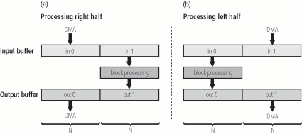

# Session 3

## Hoe gaat het?
- voortgang
- vragen
- repos check - **git is randvoorwaarde**

## Content 
* ### RECAP session 1 & 2 

_(the below - possibly in a different order)_

* ### (pure) virtual methods & abstract classes
  * <b>slides - session 3</b>
  * <u>**example: 1_override**</u> and <u>**example: 1_override_final**</u> 

* ### callback
  Audio callback functionality
  

_source: https://audiodsplab.wordpress.com/ping-pong-buffer-audio-stream/_

    

* ### oscillators
  <u>**example: 2_sineSquareSaw and 3_sineSquareSaw_final**</u>
    1. let's add Sine as subclass of Oscillator 
    2. add subclass square
    3. add subclass saw --> assignment

* ### 2026-2027 - Peer review

* ### class diagram
  Eindopdracht class diagram - kort bespreken - zie _assignments/3_assigments.md

