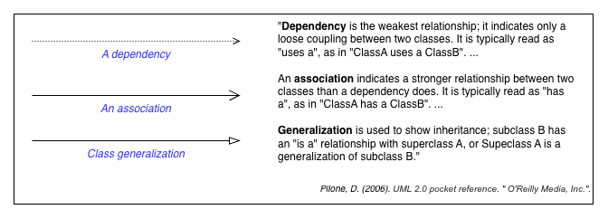
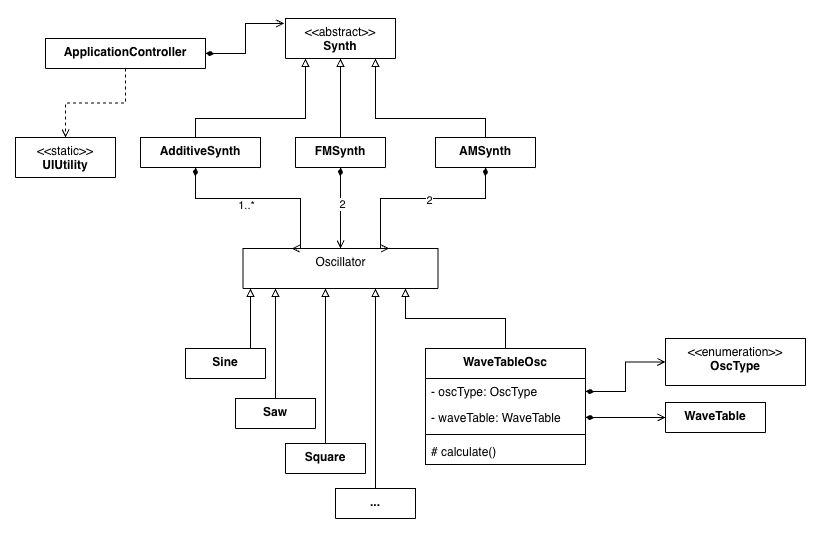

# Session 3 - assignments

## 1. Deliverable - Class diagram eindopdracht
_deadline: session 4_

Stel een class diagram op voor jouw eindopdracht ontwerp. Hanteer UML vormgeving voor has a en is a. Zie onderstaand overzicht, in principe heb je voldoende 'association' en 'class generalization' en eventueel 'dependency' relationships.
 
 

 
_Voor een overzicht met associatie verder opgesplitst, zie _assignments/3_UML_overview.png._
Zie onderstaand diagram als voorbeeld
 
 

 

## 2. Oefenen (ook al bruikbaar voor de eindopdracht)
_DISCLAIMER: Voor het inheritance deel in deze opdracht moet je eerst 2_assigments 2.3 [WRITE][OPTIONAL] Inheritance - Oscillator, Sine, Saw and Square hebben uitgevoerd_

2.1 START AAN JE EIND OPDRACHT! 
- Stap 0 - Kopieer je eigen uitwerking van vorige week 2_assigments.md 2.3.
- Stap 1 - Werk je synth uit in de callback zoals we tijdens de sessie hebben gedaan, zie ook _03_session/3_sineSquareSaw_final/callback_session_example.h & .cpp
- Stap 2 - Stel een Synth class op waarin je de code van stap 1 verwerkt.  
- Stap 3 - schrijf je Synth class om tot een base class en werk je synth van stap 2 uit tot een derived class

2.1 **[WRITE] VOOR MELODY FOCUS** 
- Start aan de MelodyGenerator class die een method heeft die een melody in de vorm van een array teruggeeft

2.2 **[WRITE][OPTIONAL] Note en Melody class**
- Werk een Note class uit die straks in je eindopdracht te gebruiken om een melody mee af te spelen. Deze Note class bevat i.i.g. properties voor de toonhoogte als MIDI waarde, velocity en duration.
- Bekijk het voorbeeld _assignments/2_melody en voeg een Melody class toe aan je eigen code met een array met Note objecten in plaats van midi waardes als integers. 
- Combineer deze Melody class met je Synth code.

